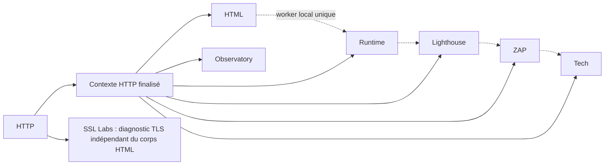

# Progression atomique et concurrence bornée — #212 / #236

La progression conserve le tableau JSON `{id,label,status}` et l'ordre des huit
modules. Une transition normale passe de PENDING à RUNNING puis à un état terminal.
Les états terminaux ne sont pas réécrits par un retry ou une réponse tardive ; une
reprise explicite réinitialise le tableau. Un run hors RUNNING n'accepte pas une
transition normale. La clôture d'un run FAILED par le reaper peut encore remplacer
ses seuls modules RUNNING par FAILED.

`AuditRunDao.updateModuleStatus` exécute un seul UPDATE JSON_SET. JSON_SEARCH
localise le module par son ID, y compris dans un tableau historique réordonné.
Les autres statuts, labels et `result_json` ne sont pas chargés ni remplacés.
Un JSON absent/corrompu/vide repart de la liste initiale ; un tableau non vide
sans l'ID visé est conservé. Huit modules et deux transitions : **16 UPDATE**,
contre **16 SELECT + 16 UPDATE** précédemment. Le nettoyage exceptionnel reste
une transition atomique par module ; il ne remplace plus le tableau entier.

## Graphe et capacité

HTTP constitue la barrière de dépendance : son résultat est attendu puis le
contexte est enrichi avant toute soumission des autres modules. Les flèches
pleines décrivent les dépendances de données ; la chaîne locale impose aussi
l'ordre d'utilisation du worker unique.



Un snapshot HTTP indisponible empêche l'analyse des modules qui le consomment ;
SSL peut encore diagnostiquer le certificat du hostname initial. Seuls les modules
sélectionnés par le périmètre du run sont exécutés. Tech conserve son cache.

`audit.execution.max-concurrent-modules` borne les modules actifs dans cette
instance backend. La valeur est explicitement choisie après mesure de la capacité
du serveur ; le nombre de CPU ne déclenche aucune augmentation automatique.

| Valeur | Exécution après HTTP | Usage |
| --- | --- | --- |
| **1 (défaut)** | Tous les modules séquentiels dans l'ordre du catalogue ; aucun pool distant créé | Baseline et repli Raspberry |
| 2 | Un worker local et un worker distant ; SSL attend derrière Observatory | Premier palier à mesurer |
| 3 | Un worker local et deux workers distants | Ancien pilote #236, à activer seulement après mesure |

Une valeur hors de 1..3 est refusée à la construction. Le pool distant partagé
conserve une queue bornée de deux tâches et refuse les travaux supplémentaires
en mode dégradé. HTML, Playwright, Lighthouse, ZAP et Tech restent séquentiels
sur le worker local. Aucun palier ne parallélise les navigateurs, ni les runs du
scheduler. Un appel tiers ignorant l'interruption peut continuer à occuper son
worker ; aucun thread de remplacement ne contourne cette borne.

Le rapport assemble les résultats et statuts dans l'ordre historique, quel que
soit l'ordre de fin, et effectue une seule tentative de publication par traitement.
L’atomicité globale est décrite dans [la publication](../security/audit-publication.md).

`audit.remote-modules.timeout` règle le délai par appel distant, queue comprise
(défaut : 2 minutes, durée strictement positive). En parallèle, les deadlines
démarrent à la soumission, y compris pour la tâche en queue au palier 2 ; attendre
le premier résultat ne donne pas un nouveau budget au second. En séquentiel, le
budget distant démarre au tour du module sur le worker local. Dans tous les modes,
`audit.timeout` (120 s par défaut) borne la collecte et réserve le temps de
publication selon le [contrat de deadline](deadline.md).
Une expiration annule la tâche et produit un résultat indisponible,
non scorable, avec TIMEOUT. Les tâches distantes ne touchent ni la DB, ni les
statuts, ni le rapport final : une réponse après annulation ne peut les modifier.
Le MDC runId/module est transmis puis restauré. Le shutdown de l'application
interrompt le pool et attend au maximum cinq secondes. Les appels HTTP et polls
Java sont interruptibles ; un code tiers ignorant l'interruption ne crée pas de
thread supplémentaire et reste limité par le pool. Une annulation du run ferme
les tâches distantes sans publication. Les logs `audit_execution` et le champ
`meta.maxConcurrentModules` permettent d'identifier le palier d'une mesure.

Pour un fichier externe HOCON, ces clés peuvent être surchargées séparément :

```hocon
audit.execution.max-concurrent-modules = 1
audit.timeout = 120s
audit.remote-modules.timeout = 2m
```

Revenir à 1 et redémarrer le backend constitue le repli séquentiel. Ne pas changer
les budgets, pools HTTP/DB et concurrence simultanément pendant une comparaison.

## Mesures avant activation sur Raspberry

Le dimensionnement matériel reste **à mesurer**. Les tests locaux et la CI ne
prouvent pas la capacité du Pi. La livraison garde donc le palier 1 ; une future
concurrence browser exige un lot séparé et de nouvelles mesures.

Sur un Pi de staging autorisé, conserver SHA, modèle/CPU/RAM, limites Docker,
options JVM, versions des collecteurs et réglages effectifs. Reprendre le protocole
[des pools HTTP/DB](../performance/resource-pools.md) pour les métriques système.
Comparer le **même SHA** avec les paliers 1, puis 2, puis 3 seulement si le palier
précédent est acceptable. Faire trois répétitions par palier, avec la même liste
de cibles de test autorisées et le même état des caches (distinguer SSL chaud et
froid). Garder les mêmes timeouts et l'intervalle scheduler de 5 s.

Pour chaque répétition : deux audits de chauffe puis dix audits soumis ensemble
sur la seule instance de staging ; attendre la vidange de la file et deux minutes
de reprise. Conserver, sans URL ni token :

- `audit_end durationMs`, `meta.moduleStatuses`, complétude, nombre de rapports
  par run et nombre de succès/échecs/timeouts ; vérifier une seule publication.
- `docker stats` pour backend, Playwright, Lighthouse, ZAP et MariaDB toutes les
  secondes, plus `pidstat -r -u -t -p <pid-backend> 1` : CPU moyen/pic et RSS pic,
  mémoire totale des conteneurs, GC et éventuel throttling/OOM. Mesurer les
  headless aussi : le seul heap Java ne représente pas la mémoire du serveur.
- Dans la base de staging, exporter seulement `id,status,created_at,started_at,
  finished_at` des dix runs : attente = started_at − created_at ; durée traitée
  = finished_at − started_at ; débit = runs terminés / durée entre soumission
  du lot et dernière fin. Relever le nombre de QUEUED à chaque seconde.

Archiver données brutes et tableau agrégé dans `outputs/` ou les artefacts de
recette associés au SHA. Aucun résultat Raspberry n'est encore revendiqué :

| Mesure (trois répétitions, caches identiques) | Palier 1 | Palier 2 | Palier 3 |
| --- | --- | --- | --- |
| Durée run p50/p95, attente p95 | à mesurer | à mesurer | à mesurer |
| CPU moyen/pic, RSS pic et mémoire conteneurs | à mesurer | à mesurer | à mesurer |
| Débit du lot, profondeur max et temps de vidange | à mesurer | à mesurer | à mesurer |
| Complétude, timeouts, erreurs, rapports par run | à mesurer | à mesurer | à mesurer |

Avant promotion, consigner les budgets CPU/RAM acceptables pour le modèle mesuré.
Exiger zéro OOM, une publication par run, aucune baisse de complétude ni hausse
des erreurs/timeouts, un gain de débit reproductible et un retour à la mémoire
nominale après reprise. Sans ces preuves, conserver 1. La validation matérielle
de #212 reste ouverte ; cette procédure ne constitue pas un déploiement.

## Validation

`mvn test` couvre le pool, saturation, deadline, annulation, contexte MDC,
ordonnancement et publication unique via fixtures. La synchronisation par latch
prouve le chevauchement SSL/Observatory avec le travail local ; aucun navigateur
ou site tiers n'est exécuté. Le gain structurel est le passage de la somme des
durées à leur chevauchement, sans promesse de latence Raspberry.

Le workflow `MariaDB integration` lance `mvn -P mariadb-integration verify` sur
MariaDB 11.4, la version de production, avec une base dédiée
`argos_progress_test`. Il teste le vrai DAO/SQL QueryDSL : vingt paires de
transitions concurrentes, état terminal,
retry, JSON invalide, ordre historique, clôture reaper et blob intact. Les rapports
Failsafe sont conservés en artefact lié au SHA. Le profil échoue si l'URL de la
base isolée n'est pas renseignée ; aucune DB d'exploitation n'est utilisée.

Le test `normalProgressUsesSixteenUpdatesAndNoSelectInsteadOfThirtyTwoStatements`
imprime les nombres de statements et durées avant/après sur la fixture MariaDB.
Ces timings comprennent les connexions de test ; ils ne mesurent ni le Raspberry
ni le parcours réseau réel. La matrice historique 10.11/11.4 a établi la
compatibilité initiale ; la CI courante cible la version 11.4 déployée.

Les timings de fixtures ne mesurent pas la latence en production. Conserver les résultats de chaque exécution dans les artefacts CI associés au SHA.
