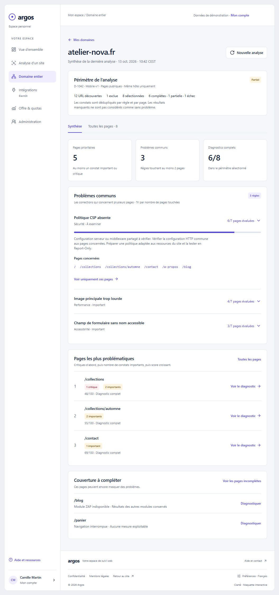

# Référence visuelle figée — Clarté

Référence retenue le 13 octobre 2026 : **liste des domaines → synthèse des
problèmes communs → pages affectées → détail de chaque page**, avec dashboard,
analyses URL, compte personnel, quotas et administration.

- [Aperçu interactif autonome](clarte.html) : télécharger/ouvrir localement.
- [Fragment original](clarte.fragment.html) : source exacte de la maquette retenue.
- [Manifeste](manifest.json) : provenance, empreintes SHA-256 et captures figées.
- [Écarts à corriger à l’intégration](../decisions.md) : règles et chiffres priment.

L’aperçu contient **uniquement des données fictives** et simule ses actions en
mémoire. Il ne contacte aucune API Argos, ne crée aucun compte et ne constitue
pas une implémentation de sécurité. Les hooks optionnels du fragment vers
l’hôte de conversation sont inactifs dans l’aperçu autonome. Aucun stockage
local n’est ajouté. Une dépendance CDN Lucide versionnée charge les icônes ;
hors réseau, utiliser les captures. Le CSS utilise `light-dark()` dans un
navigateur moderne. Cette page n’est pas destinée au déploiement public.

## Captures principales

| Écran | Desktop | Mobile |
|---|---|---|
| Mes domaines | [1056](screenshots/domain-list-1056.png) | [390](screenshots/domain-list-390.png) |
| Synthèse | [1056](screenshots/domain-summary-1056.png) | [390](screenshots/domain-summary-390.png) |
| Pages affectées | [1056](screenshots/affected-pages-1056.png) | [390](screenshots/affected-pages-390.png) |
| Rapport d’une page | [1056](screenshots/page-report-1056.png) | [390](screenshots/page-report-390.png) |
| Dashboard | [1056](screenshots/dashboard-1056.png) | [390](screenshots/dashboard-390.png) |
| Compte | [1056](screenshots/account-1056.png) | [390](screenshots/account-390.png) |
| Quotas | [1056](screenshots/quota-1056.png) | [390](screenshots/quota-390.png) |
| Administration | [1056](screenshots/admin-detail-1056.png) | [390](screenshots/admin-detail-390.png) |



## Reproduction

Depuis la racine du dépôt :

```text
python docs/connected-space/reference/build-preview.py
node docs/connected-space/reference/capture.cjs
python docs/connected-space/validate.py
```

`capture.cjs` utilise Playwright installé dans `apps/playwright-service` et
Chromium disponible. On peut fournir `CLARTE_BROWSER_PATH` (exécutable local)
et `CLARTE_PLAYWRIGHT_MODULE` (module déjà installé ailleurs) sans modifier le
script. La sortie par défaut est `outputs/clarte-reference` ; passer un dossier
en premier argument pour une revue isolée. Ne pas remplacer les références
figées simplement parce que le rendu produit diverge.

Les snapshots versionnés portent une décision visuelle, conformément à
l’exception de conservation de `docs/README.md`. Les futures preuves de tests
produit vont dans les artefacts CI/PR associés au SHA, pas dans cette référence.
Le script vérifie navigation, compteurs illustratifs, h1/footer et débordement
à 320/390/768/1056. Il ne certifie ni l’accessibilité complète, ni les règles
serveur, ni la fidélité du produit futur.
