# Rapports : comparaison à la maquette validée

Référence : `argos-rapport-unifie.html`, validée dans la conversation du 15 octobre 2026. SHA-256 : `041d6db997def3b1974ecaa4fd2a96222791850a85c2255dc9db1650c0d4d413`.

Cette comparaison est un relevé figé, conservé à son chemin avec ses captures et
résultats. Elle ne décrit pas automatiquement le rendu courant. Pour modifier le
lecteur ou rejouer sa validation, partir du [contrat actuel](../report/unified-reports.md)
et de la [recette web/PDF](../testing/report.md).

À gauche : captures de la maquette originale dans un iframe isolé. À droite : **build de production Next.js**, vraies routes avec une API locale fictive. La largeur du conteneur de référence est ajustée à celle du rapport réel (écart inférieur à 2 px). Aucun CSS du produit n'est remplacé pour la capture. Les captures portent sur le corps du rapport ; la navigation extérieure du compte reste celle de l'application.

| Variante / fenêtre | Maquette validée | Application corrigée |
|---|---|---|
| Public / 1120 px | 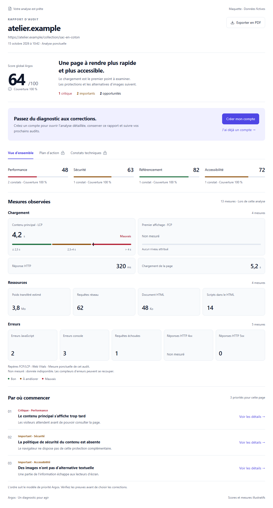 | 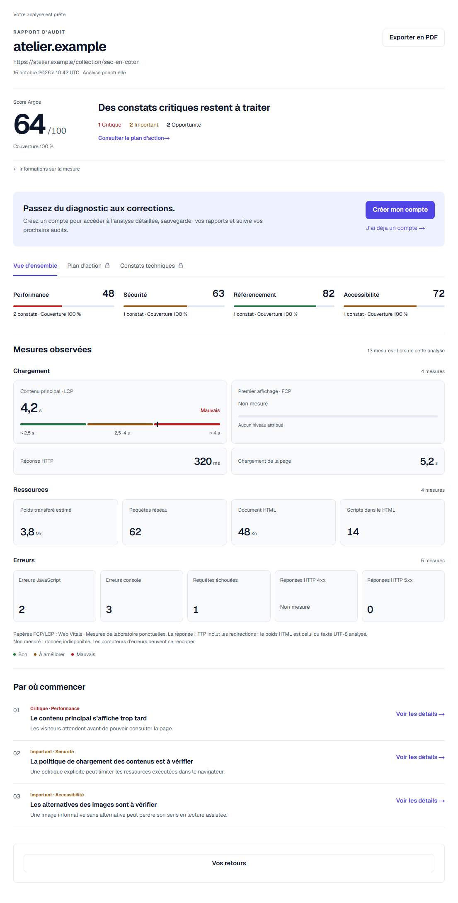 |
| Connecté / 1120 px | 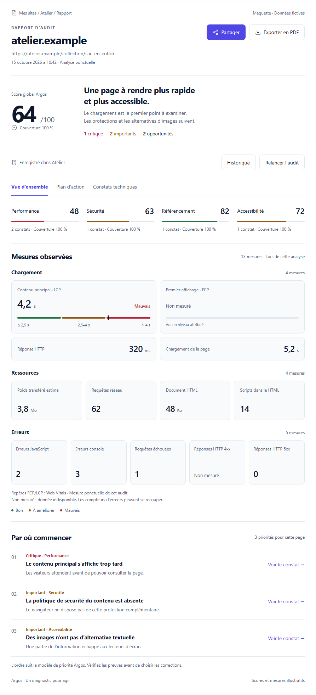 | 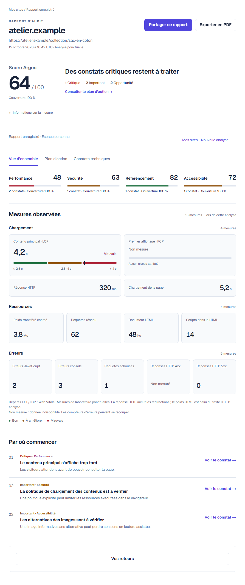 |
| Partagé / 1120 px | 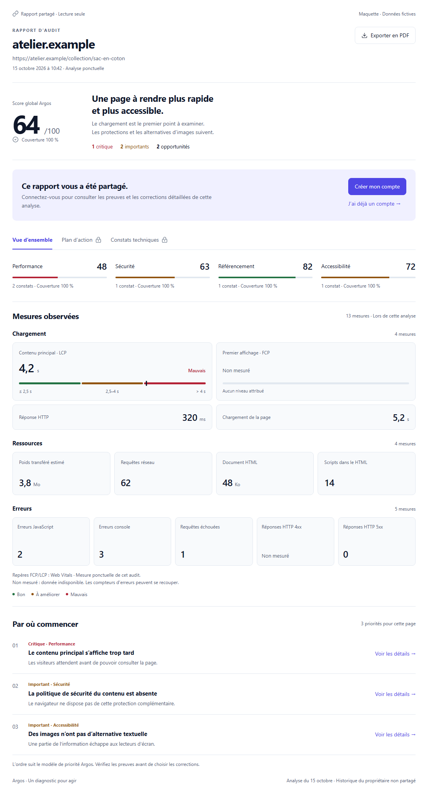 | 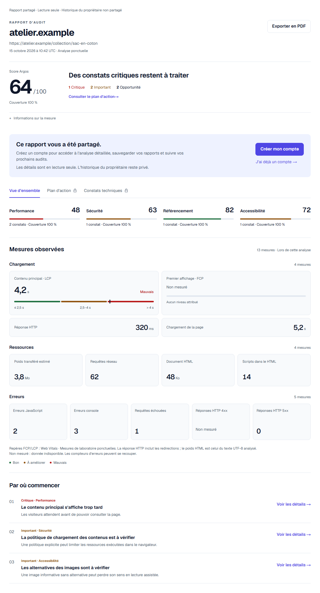 |
| Public / 390 px | 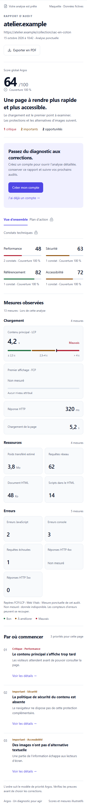 | 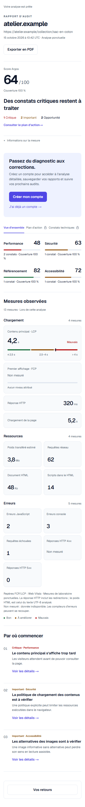 |
| Connecté / 390 px | 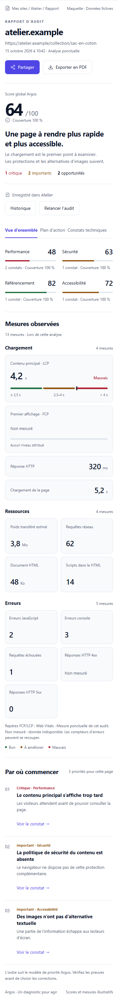 | 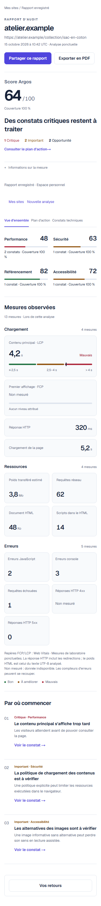 |
| Partagé / 390 px | 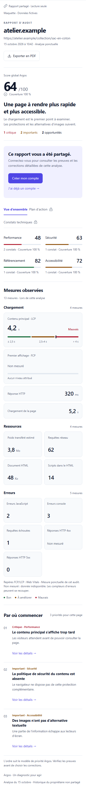 | 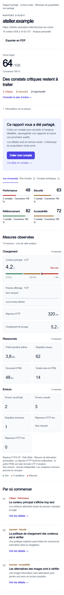 |

## Changements vérifiés

Identité et URL complète en tête, score à gauche du verdict, compteurs en ligne, invitation contextuelle, onglets, quatre scores sans cartes imbriquées, mosaïque compacte des 13 mesures, puis trois priorités en lignes numérotées. PDF et partage sont dans l'en-tête du rapport. Le connecté utilise le même lecteur avec ses actions personnelles. Le rapport d'exemple réutilise aussi ces composants.

Le verdict et les constats restent calculés depuis le modèle et le catalogue du produit, sans substitution par les phrases fictives de la maquette. Les précisions de mesure sont repliées dans « Informations sur la mesure ». Langue/thème, date UTC, précisions de laboratoire et retour utilisateur sont conservés. Ces différences sont explicites : les captures ne prétendent pas à une égalité pixel par pixel.

Le panneau PDF débordait à 390 px dans le connecté. PDF et partage sont maintenant ancrés sur la largeur disponible du groupe d'actions en mobile. Le bandeau du rapport n'est plus collant, conformément à la référence ; il ne masque plus le titre lors du défilement.

## Pourquoi « Non mesuré » ?

Les deux réponses API fournies par l'utilisateur ont été examinées en lecture seule. L'ancien rapport, publié à 16:15 UTC, ne contenait pas `measurements`. Le nouveau, publié à 20:19 UTC, contient les 13 valeurs et huit modules terminés. La collecte actuelle fonctionne.

Pour un ancien instantané sans mesures, le lecteur tente une extraction numérique autorisée depuis le `result_json` conservé du run. Il ne republie pas le rapport, ne recalcule pas les scores et ne transmet aucune preuve brute. Les zéros restent des zéros. Une source supprimée, invalide ou sans la mesure laisse celle-ci indisponible. Un rapport expiré ne déclenche pas la récupération. Aucune migration ni réécriture de production n'a été effectuée.

## Validation

- Backend : `mvn test`, 825 tests, aucune erreur ni échec.
- MariaDB réelle : profil `mariadb-integration`, `AuditPublicationIT`, 8 tests réussis, dont récupération historique sans modification de l'instantané publié.
- Frontend : 874 tests réussis ; 27 tests ciblés rejoués après les dernières finitions ; build de production réussi.
- PDF : 24 exports public/propriétaire/partagé, FR/EN ; pagination de 110 pages contrôlée. La mise en page PDF existante n'a pas été changée.
- Chromium : 64 cas, 320/390/768/1120 × clair/sombre × FR/EN × public/propriétaire/partagé anonyme/partagé connecté. Vérification des 13 mesures, du titre unique, de l'accès aux constats, des menus PDF/partage, de l'absence de débordement horizontal et d'erreur JavaScript. Voir `results.json`.
- Examen des captures desktop/mobile public, connecté et partagé. Le navigateur intégré a servi à la comparaison initiale ; sa reconnexion finale à localhost a échoué. Les captures et parcours finaux proviennent de la recette Chromium du dépôt.

La fixture inclut FCP et HTTP 4xx absents, et HTTP 5xx égal à zéro. Ces vérifications ne constituent pas un audit WCAG, ni un test de lecteur d'écran ou de zoom à 200 %. La présence du résultat brut de l'ancien audit en production n'a pas été vérifiée : la récupération dépend de sa conservation.

## Rejouer

Installer les dépendances frontend et `playwright-service`. Démarrer `scripts/e2e/report-fidelity-fixture.mjs` avec `REPORT_FIXTURE_PORT=3091`. Construire et lancer Next sur 3040 avec `API_BASE=http://127.0.0.1:3091`. Servir la maquette originale avec le renderer isolé de la visualisation sur 3041. Exécuter `node scripts/e2e/report-fidelity.mjs` depuis la racine. Aucun compte ni rapport de production n'est utilisé.

Les captures exhaustives et journaux sont dans `outputs/ui-review/report-fidelity/` (ignoré par Git). Les douze captures comparatives ci-dessus sont versionnées pour les reviewers distants.
